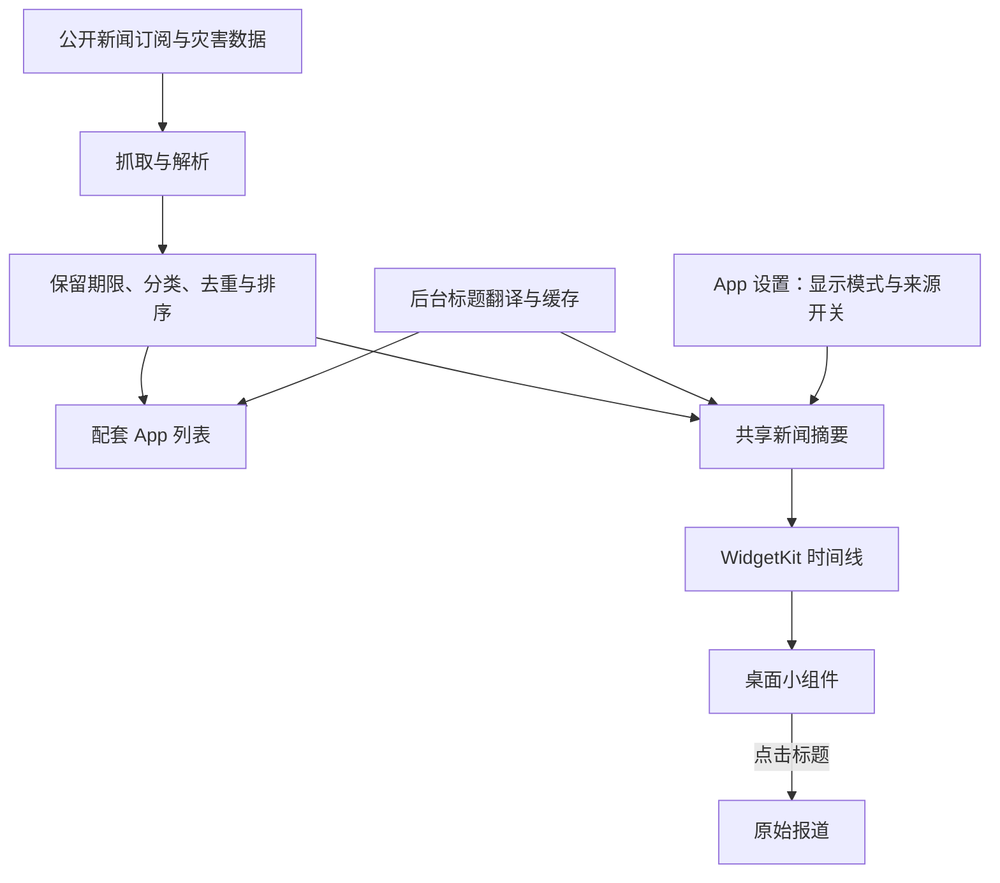

# 世界动态：App 与桌面小组件设计说明

版本：2.8（Build 18）

文档日期：2026-10-30
适用范围：当前已实现的 macOS 应用与 WidgetKit 桌面组件

## 1. 产品定位

世界动态是一款面向个人阅读的中文资讯工具，把国内外多个公开新闻订阅汇集到 Mac 上，帮助用户快速了解政治、财经、科技、文娱、体育及灾害动态。

日常使用以桌面小组件为入口，扫一眼即可看到几条报道；需要查看更多内容、筛选领域或调整来源时，再打开配套应用。英文标题自动翻译为中文，同时保留原文和报道链接。

当前默认体验是：**最新报道在上，有新增时插入，已有条目向下移动；没有新增时保持原位。** 用户也可以主动切换到覆盖不同领域的综合轮播。

产品采用 Swift、AppKit、SwiftUI 与 Apple WidgetKit 构建。配套应用是普通原生窗口，桌面组件由 macOS 的小组件系统管理。

## 2. App 与小组件的分工

| 项目 | 配套 App | 桌面小组件 |
| --- | --- | --- |
| 主要用途 | 阅读完整列表、筛选、配置 | 快速浏览少量报道 |
| 内容容量 | 所有来源合计缓存最新 100 条 | 按标题长短自动排满：小约 1–2 条，中 2–4 条，大 5–8 条 |
| 阅读操作 | 滚动列表、切换范围、打开原报道 | 点击标题打开原报道 |
| 配置入口 | 来源开关、新闻过滤、检查间隔、组件显示模式、翻译语言准备（独立设置窗口） | 无；点击空白处打开 App |
| 刷新方式 | 运行时默认每分钟检查 | 接收 App 摘要，也可按系统调度独立检查 |
| 关闭后的行为 | 关闭窗口后仍可在菜单栏运行；“退出”才结束 App | App 退出后仍可按系统调度工作 |

配套窗口可以移动和调整大小，默认约为 420 × 610 点，最小为 350 × 350 点。它使用普通窗口层级，当前没有额外的“始终置顶”开关。

## 3. 配套 App 的界面设计

### 3.1 布局与信息层级

界面采用 macOS 原生的克制风格：透明标题栏与内容融为一体，跟随系统浅色／深色外观。

1. **标题区**：大号「世界动态」，右侧依次为实景／新闻切换、刷新与设置三个无边框图标。
2. **状态行**：标题下方一行小字，显示检查时间与可用来源数；只有来源异常或检查过久时才出现橙色圆点。右侧是范围菜单（如「最新 · 508 条」）。
3. **内容区**：新闻列表；翻译未就绪时在列表上方显示一条浅色提示。没有内容时使用系统的空状态样式。

每条报道上方一行为来源（加粗灰色）与时间（右对齐，今天显示时刻，昨天显示「昨天」，更早显示日期），下方为标题。鼠标悬停时整行出现浅色圆角高亮，并可在提示中看到英文原文。条目不再显示「机译」「缓存」标记。

设置在独立的「设置」窗口中（菜单栏图标 → 设置…，或 ⌘,），使用系统分组表单：小组件、新闻过滤、更新、翻译、世界地图、城市实景、来源七组。

### 3.2 阅读范围

范围菜单提供：综合、最新、国内、国际、政治、财经、科技、文娱、体育、灾害。

| 范围 | 行为 |
| --- | --- |
| 最新 | 所选来源的报道按时间倒序展示 |
| 综合 | 不同领域混排，并把当前轮播组放到列表前面 |
| 国内／国际 | 按来源的覆盖范围筛选 |
| 政治、财经、科技等 | 按条目分类筛选 |

**阅读范围与组件显示模式是两个设置。** 范围菜单控制当前 App 列表；设置中的“最新优先／综合轮播”控制桌面组件。切换组件模式时，App 会同时跳到相应的“最新”或“综合”视图，方便预览，之后仍可单独筛选 App 的阅读范围。

列表旁的条目数表示当前过滤和范围内可用的总数，不表示屏幕上一次能看到的数量。范围菜单顶部可切换全部新闻／个性新闻；个性新闻时状态行显示「· 个性新闻」。

新闻过滤默认全部新闻。个性新闻使用领域与来源选择、关注词和屏蔽词：屏蔽词优先；关注词可覆盖领域／来源选择；开启「只看含关注关键词的新闻」后只看命中关注词的条目。原文与译文都参与匹配，不区分大小写，繁简体统一；纯 ASCII 关键词采用单词边界。各关键词列表去重并最多保留 50 个。来源总开关控制抓取，过滤来源仅控制新闻显示，已停止抓取的来源不能在过滤设置里勾选。设置记录未选领域与来源，新来源默认选中。

新闻过滤作用于各 App 新闻范围、新闻组件与总览新闻列；过滤先于去重、排序和国内占比。地图、抓取与翻译仍使用未过滤的来源数据。没有符合条件的新闻时，App 提供「调整过滤」，新闻组件显示「没有符合个性设置的新闻」。

### 3.3 视觉语言

应用正文、控件和设置使用系统语义颜色（主要、次要、三级文字）与系统字体，不再强制深色或自定义色值；图片上的城市标签保留白字与浅黑胶囊底，以保证照片上的可读性。异常时只用橙色，灾害等级用红／橙色文字。不使用卡片、阴影或装饰动画，以留白、字重与层级组织内容。

## 4. 桌面小组件设计

新闻组件只显示新闻本身，不显示图标、产品名、模式、刷新按钮或底部状态行。每条为一行来源与时间，下方为标题。

**自适应排布**：组件拿到比可见数量稍多的候选，按每条标题的实际高度从上往下排；排不下整条时，若剩余空间足够则显示一条截断的标题，否则把剩余空间平均分到条目之间（每处最多约 14 点）。这样无论标题长短都能填满组件，不留大块空白。

| 尺寸 | 条目数 | 使用场景 |
| --- | --- | --- |
| 小 | 约 1–2 条 | 桌面空间有限，关注最上方一条报道 |
| 中 | 约 2–4 条 | 同时浏览少量标题 |
| 大 | 约 5–8 条 | 保留一个简短、连续的新闻列表 |

组件使用 WidgetKit 的系统背景和容器，外观随 macOS 的组件呈现方式变化，不强行复制配套 App 的深色底板。标题默认限制行数，来源信息在空间不足时截断，优先保证标题可读。

组件内不提供长列表滚动。用户点击标题阅读原报道，需要完整列表时进入 App。

### 4.1 地图、实景和组合总览

原有 `WorldWatchNews` 及其小、中、大尺寸保持不变。新增 `WorldWatchDashboard`（超大）、`WorldWatchMap`（大、超大）和 `WorldWatchLive`（中、大、超大）。总览左列上半部是地图，下半部为 2×2 实景，右列复用新闻自适应排布。实景中号显示前两座城市，其余尺寸显示四座。

地图使用 SwiftUI Canvas 和内置 Natural Earth 公有领域数据，采用等距圆柱投影，按组件宽高比扩展地区范围而不拉伸地图。地图文字只显示国家英文名；24 小时内 M6.0 及以上地震，以及进行中或三天内结束的 GDACS 红／橙预警显示图形。活跃台风显示半透明图标及约未来 12 小时预测虚线，GDACS 线段不含时间戳，该范围是按历史平均步长估算。世界总览以四色小圆点表示截图城市。

冲突填色复用国家多边形，在陆地之后、夜间阴影之前绘制。只计 48 小时内非国内、非灾害来源的冲突标题，每条取最高词权重，按 3／8／16／30 分四档深浅填红，最多 15 国。**按 48 小时新闻中冲突类报道的数量与严重程度估计，颜色越深越严重；非核实的冲突数据**。伤亡词只有与冲突词或袭击语境同时出现才计分；旧新闻热点关闭偏好迁移为冲突板块关闭。新闻显示过滤不参与地图数据计算。

ISS 按条目日期在前后约 45 分钟的轨迹上插值，以淡色卫星图形及虚线表示；跨 ±180° 断线。城市名称、时间与天气不在地图显示，不再请求天气。

城市截图只标左下角英文城市名，用细小白字与浅黑胶囊底。点击打开对应图片的来源页面；地图和空白处打开 App。所有组件跟随系统背景，均无标题栏、刷新按钮或底部状态。

每个新组件每 3 分钟预排一个条目，共约 10 个，按条目时间重算昼夜及 ISS 位置；条目过多或图片过大时系统会拒收整份时间线，组件只显示灰色占位，所以截图在组件内按约 360 像素解码。每城最多三张图，按 `(绝对 3 分钟序号 + 城市序号) % 张数` 轮换，避免新闻刷新后重置到第一张；此公式让城市的图片索引错开，实际切换时刻仍相同且受 WidgetKit 调度控制。它不保证逐分钟重绘。

### 4.2 新设置与主窗口

世界地图提供八个范围预设，以及地震、台风、洪水与火山、冲突板块、昼夜分界、国际空间站六个图层开关，默认全部开启，每项附来源说明。城市实景提供 5／10／15／30 分钟抓取间隔；十城中最多勾选四城，默认北京、东京、纽约、伦敦，可上下移动排序。达到四城后，其他城市的勾选禁用并显示上限说明；列表显示成功时间或实际错误。每城可展开来源列表，逐个查看平台、原标题、实时／待验证／静态封面／未开播／失败状态与最近变化时间，并独立开关镜头。新增默认开启的 SkylineWebcams 预览图总开关及个人使用说明。「立即重新检测」清空所选城市冷却并重检；Skyline 仍遵守设定间隔。

主窗口点击实景图标后，新闻区域切换为四张图片预览，再次点击回到新闻。图片共用组件缓存，保持原生简洁布局。

摄像头使用持久化的跨平台来源池：YouTube 正在直播的缩略图、B 站 keyframe、SkylineWebcams 预览 JPEG，以及香港天文台、伦敦 TfL、东京国土交通省官方图片。搜索候选合并后写入 App Group `sources.json`。十城均尝试 B 站街景搜索，排除电竞、聊天、点歌等；本轮仅北京有确认可用的 B 站固定镜头。固定 YouTube 候选保留频道，原直播结束后用频道 `/live` 查找符合城市及摄像头语义的新直播。

每个来源的健康记录保存到 `health.json`：首次有效图片「待验证」；至少相隔四分钟比较 SHA-256、64 位 dHash 和灰度采样，像素变化后才标为「实时」。连续两次未变化判为封面并冷却六小时；尺寸或字节数过小、近纯色、平台声明未开播或 Last-Modified 超过两小时则冷却一小时。失败按 10／30／120／360 分钟退避。变化检测只说明缩略图发生变化，不能保证与直播视频同步，尤其低光、压缩噪声或含动态小区域的封面仍可能误判。

每城每轮按实时、待验证顺序取最多三张，第三张尽量换平台；坏源当轮顺延。来源全失效时保留旧图，无缓存则显示英文城市名和 photo 图标，原因留在设置中。禁用来源后停止请求并从 App 与新生成的 Widget 时间线隐藏。Skyline 带浏览器 UA、遵守抓取间隔及冷却，点击图片打开原观看页。实际逐城来源与状态见《升级验收记录-2.6.md》。

截图循环独立于新闻检查，只抓当前选中城市，最多四城并行；修改间隔不取消正在进行的请求。新组件发现图片过期超过两倍间隔时，以约 20 秒总预算尝试每城一图。图像最长边 640px，以 JPEG 约 0.7 质量存入 App Group；按批次写图后原子切换 manifest，避免现有时间线读到新图片配旧链接。过期批次在两小时后清理，当前图片不因连接失败而被删除。

## 5. 两种显示模式

入口：**App 右上角齿轮 → 设置窗口 → 小组件**。使用原生分段选择器，在“最新优先”和“综合轮播”之间切换。模式会持久保存，并共享给组件；切换后立即请求系统更新。

### 5.1 最新优先：默认模式

按来源提供的报道时间从新到旧排列。相同时间使用稳定 ID 排序，避免网络请求完成顺序改变列表。

以下为交互示意，不是真实新闻：

| 位置 | 更新前 | 新报道 N 到达后 |
| --- | --- | --- |
| 第 1 条 | A · 10:03 | N · 10:04 |
| 第 2 条 | B · 10:02 | A · 10:03 |
| 第 3 条 | C · 10:01 | B · 10:02 |
| 第 4 条 | D · 10:00 | C · 10:01 |

一条新报道插入时，旧条目下移一位；同批有多条新增时，按时间顺序一起更新。超出组件容量的末尾条目退出当前显示范围，仍可在 App 中查看。

“最新”依据报道时间，而非本机首次抓取时间。延迟抓到的旧报道应插入它实际所属的位置，不会仅因刚被抓取就强行置顶。

在来源、模式与保留期限没有变化的情况下，时间流逝不会自动把最新列表换成其他旧报道。译文完成也不会被当作一条新新闻。

此模式保留相同链接、完全相同或高度相似标题的去重，但不使用综合模式的“同一国家选举”话题合并规则。它优先保证时间顺序，因此不强制每屏覆盖不同领域。

### 5.2 综合轮播：可选模式

从近期报道中按领域交替选取候选，每个领域最多 8 条，总候选上限为 64 条，再按组件尺寸分组。

每次准备未来约 60 分钟的时间线，按一分钟间隔安排轮换。同时保留标题、链接与保守的话题去重，减少同一事件占据多个位置。

该模式用于扩大阅读覆盖面。**轮播表示展示另一组已抓取报道，不表示这些报道刚刚发布。** 实际切换时刻仍由系统决定。

## 6. 动画设计

动画用于表达新旧报道的关系，帮助用户看懂列表如何变化。

| 变化 | 正常动态效果 | 系统开启“减少动态效果” |
| --- | --- | --- |
| 新条目插入 | 从顶部移动并淡入 | 轻淡入 |
| 已有条目位置改变 | 保持条目身份，平滑移动到新位置 | 减少空间运动 |
| 末尾条目退出 | 淡出 | 轻淡出 |
| 同一条报道文字更新 | 组件标题使用淡化内容过渡 | 保留温和反馈 |

实现采用 SwiftUI 原生过渡，常规弹簧响应参数约为 0.48 秒、阻尼比例为 0.92；减少动态效果时使用约 0.15 秒的淡入淡出。条目以稳定 ID 识别，更新位置时延续原条目的视觉身份。

列表动画范围受到裁剪约束，避免移动中的内容越过列表边界。没有循环播放或持续闪动的装饰动画。

配套 App 和组件均已接入这些过渡。WidgetKit 的实际播放与时机由系统控制；当前尚未直接目测验收桌面组件的动画效果。

## 7. 内容来源与处理规则

当前接入 **28 个订阅端点，来自 16 家媒体或机构**：

| 媒体／机构 | 端点数 | 栏目 |
| --- | --- | --- |
| BBC | 6 | 中文、World、Business、Technology、Entertainment & Arts、Sport |
| The Guardian | 4 | World、Business、Technology、Culture |
| 中国新闻网 | 5 | 国内、社会、国际、财经、文化 |
| CNBC | 1 | 国际财经快讯 |
| TechCrunch | 1 | 科技、AI 与创业 |
| Variety | 1 | 影视、娱乐与传媒产业 |
| USGS | 1 | 显著地震 |
| GDACS | 1 | 橙色、红色灾害预警 |
| 中央通讯社 | 1 | 国际（中文） |
| DW | 1 | English All |
| France 24 | 1 | English |
| NYT | 1 | World |
| NPR | 1 | News |
| Al Jazeera | 1 | All |
| Defense News | 1 | 国防与军事产业 |
| 联合国新闻 | 1 | All |

来源可在 App 中单独关闭，并同步影响组件。各来源合计最多保留最新 100 条，新闻最长三天，灾害最长七天；数量上限可能使较旧新闻及其地图线索提前移除。时间转换为 Mac 当前时区。普通新闻显示发布时间，USGS 显示地震发生时间，GDACS 优先显示事件开始时间。

分类基于来源栏目和标题关键词，去重基于链接、标题相似度及少量话题规则，当前没有接入 AI 语义事件聚类或全自动重要性评估。栏目分类可能不精确，翻译、去重也可能出现误差。

## 8. 更新、翻译与容错

### 8.1 更新机制

| 场景 | 当前设计 |
| --- | --- |
| App 运行 | 默认以 60 秒为目标周期检查已启用来源；可改为 3 或 5 分钟 |
| 抓取耗时较长、休眠或网络异常 | 检查与显示可能顺延，不伪造新的内容或时间 |
| 来源内容或译文发生变化 | 单个来源变化后合并约一秒写入共享摘要；影响组件新闻候选时按 15 秒间隔合并重载，其余自动请求按 55 秒间隔合并 |
| 手动刷新或切换模式 | 立即请求检查或重载，不受本应用的自动请求限流限制 |
| App 退出 | 组件请求约 15 分钟后独立检查；全部来源失败时请求约 5 分钟后重试 |

“每分钟联网检查”“每分钟安排轮播”“每分钟有新报道”是不同的事情。媒体不保证每分钟发布内容，WidgetKit 也不保证严格按一分钟重绘。最新优先模式只生成当前列表，不安排旧新闻自动轮换。

### 8.2 中文翻译

优先使用 Apple Translation 的本机中英翻译。语言包未安装时，使用 Google 公共翻译接口作为在线备用，仅发送公开新闻标题。中文来源不重复翻译。

抓取与翻译分开运行，避免翻译拖慢下一次联网检查。优先处理当前模式最需要显示的标题，再逐步翻译其他候选与完整列表，每轮最多处理 24 个待翻译标题。

原文与译文分别保存，界面不再标注“机译”。翻译失败时保留原文和已有译文缓存，后续自动重试；用户可通过原报道或 App 条目的悬停提示核对原文。

### 8.3 失败与状态反馈

- 某个来源失败：保留该来源上次成功的数据，其他来源继续更新。
- 全部来源失败：保留可用缓存，显示检查失败状态。
- 来源成功返回空列表：清理该来源旧条目，避免旧内容长期滞留。
- 翻译未完成：允许先显示原文，不阻塞其他新闻。
- 来源数下降：显示实际成功数量；它只代表连接状态，不代表报道真实性。
- 较旧请求迟到：摘要比较内容版本，单个来源按真实抓取时间保留较新结果；整轮检查时间不因增量写入提前推进。

## 9. 技术结构与数据流

App 和组件通过同团队 App Group 共享公开摘要与显示模式。组件也能在 App 退出后独立读取来源。网络连接复用系统会话，短暂连接失败只重试一次，始终保留正常证书验证。

| 位置 | 职责 |
| --- | --- |
| `Sources/Main.swift` | App 窗口、菜单栏、列表、设置、后台检查与组件同步 |
| `Sources/Feed.swift` | 来源、数据模型、解析、分类、新闻过滤、去重、模式与共享摘要 |
| `Sources/TitleTranslation.swift` | Apple 翻译、在线备用与译文缓存 |
| `Widget/WorldWatchWidget.swift` | 组件尺寸、时间线、原生刷新操作、布局与过渡 |
| `Sources/WorldMap.swift`、`WorldMapData.swift` | 离线国家数据、投影、标签、昼夜、冲突评分与共享偏好 |
| `Sources/MapLayers.swift` | 台风与 ISS 解析、限量、插值、共享缓存和限时刷新 |
| `Sources/CameraSources.swift` | 来源模型、固定候选、图像指纹、健康状态、排序与平台解析 |
| `Sources/CameraSnapshots.swift` | 城市候选、网络校验、图片压缩、原子缓存、查询缓存与轮换 |
| `Sources/WorldComponents.swift` | App／组件共用地图与图片视图 |
| `Tools/build_world_map.py` | 从 Natural Earth GeoJSON 生成约 52 KB 的紧凑 Swift 数据 |
| `Tests/FeedCheck.swift` | 新闻、地图、实景解析与缓存回归，以及真实来源检查 |

应用源缓存与译文缓存位于用户的 `Library/Application Support/WorldWatch`；组件摘要与模式偏好位于应用自己的 App Group 容器。无需用户配置新闻或翻译 API 密钥。

当前构建要求 macOS 26 及以上，交付版本为 Apple Silicon，App 与扩展使用同一 Apple Development 团队签名。

## 10. 已验证范围与使用边界

历史新闻组件验收及本轮记录：

| 项目 | 验证情况 |
| --- | --- |
| 原生组件安装 | 用户已从系统图库添加到桌面 |
| 新闻获取 | 曾在实机达到 20/20 来源成功、约 500 条近期报道；数量与可用性会变化 |
| 配套 App | 已实际查看中文国内列表、跨领域内容与最新时间排序 |
| 模式切换 | 已通过 App 双向切换，确认共享摘要与持久偏好同步，最终保留最新优先 |
| 系统时间线 | 日志确认最新模式接收单条当前时间线，轮播模式接收 60 条计划条目 |
| 排序与缓存 | 最新置顶、旧条目下移、无新增不换页、旧缓存兼容、来源失败与迟到请求保护均有回归检查 |
| 桌面动画观感 | 原生过渡已实现并编译；自动化仍无法直接读取该桌面组件，尚未完成动画目测验收 |

本轮新闻过滤测试、构建、安装、chronod 与 NSHostingView 预览范围详见《升级验收记录-2.8.md》，其中明确列出未验证内容。

本产品用于聚合公开资讯，不能保证覆盖全球全部大事件，也不作为紧急预警服务。它展示的是来源已公开的报道，发布时间不总等于事件发生时间。重要内容应打开原始报道核对。

地图数据许可：[Natural Earth Terms of Use](https://www.naturalearthdata.com/about/terms-of-use/)，公有领域。

## 11. 设计依据

- [Apple：Keeping a widget up to date](https://developer.apple.com/documentation/widgetkit/keeping-a-widget-up-to-date)：时间线、系统刷新预算与调度。
- [Apple：Animating data updates in widgets and Live Activities](https://developer.apple.com/documentation/widgetkit/animating-data-updates-in-widgets-and-live-activities)：原生更新动画、条目身份与过渡。

本文以当前 2.8 版实现和实际验证记录为准，不把后续设想记作已经实现的功能。

## 12. 2.7 地图缓存与范围

App 地图循环约每 30 分钟刷新；Widget provider 在缓存检查时间超过一小时后，以两层共享约十秒预算按需请求。共享进程锁、原子 JSON 缓存与旧请求写入保护用于避免互相覆盖。台风最多五个、每个历史与预测合计最多 60 点；ISS 最多 60 点；冲突最多 15 国；组件时间线硬上限十条。

失败沿用旧数据，但台风缓存超过一天、ISS 轨迹不再覆盖条目时间时停止显示对应内容。数据与系统调度可能延迟，时间线插值并非逐秒实时定位。

本版不接入实时飞机（任务给定的匿名接口 TLS 与额度限制）、实时船舶（免费 AIS 的密钥与连接限制）和极光（单次约 900 KB）。这些上游限制本轮未重新测试。本版不显示天气。
